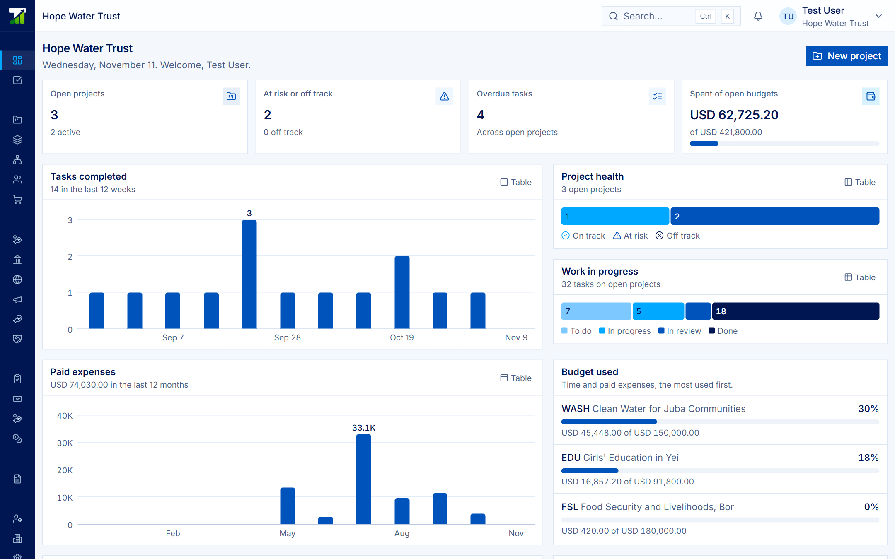
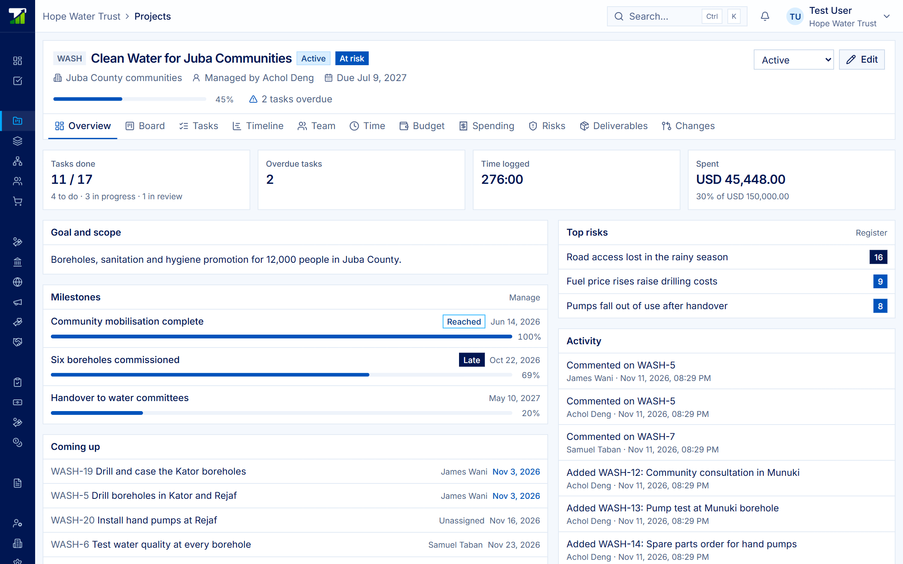
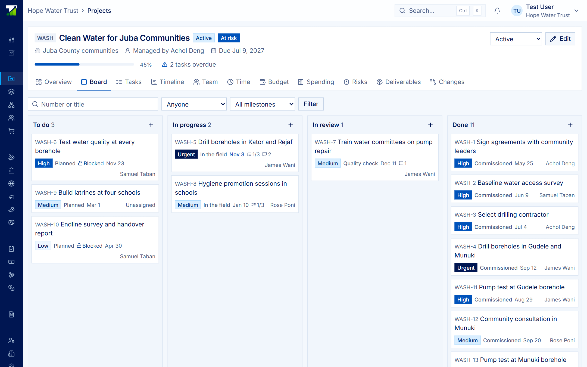
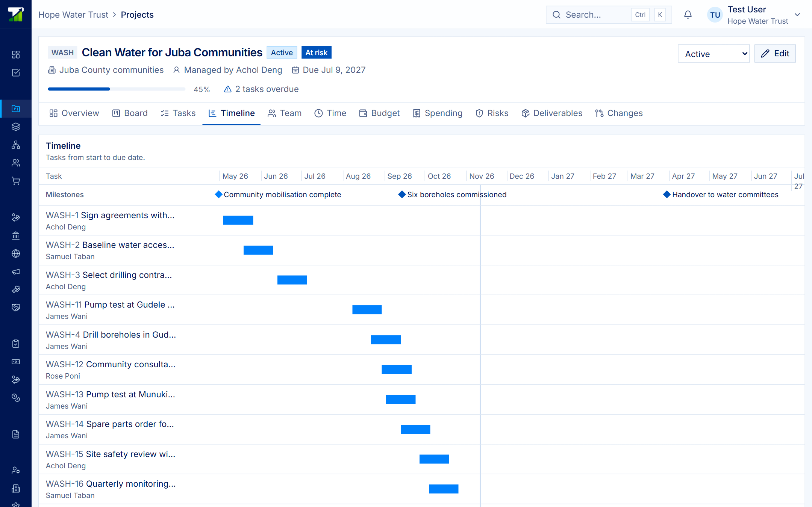
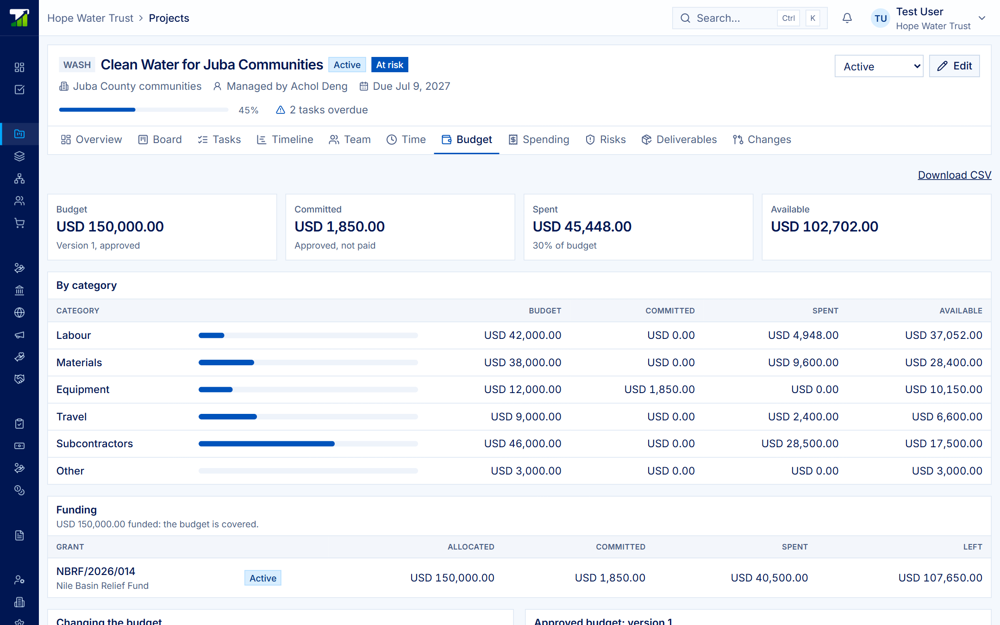
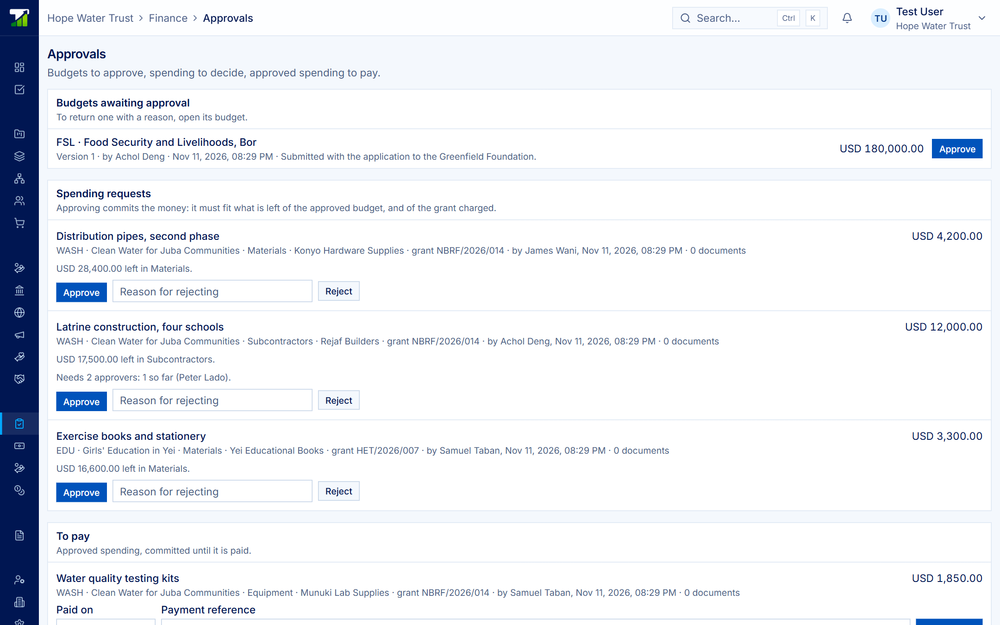
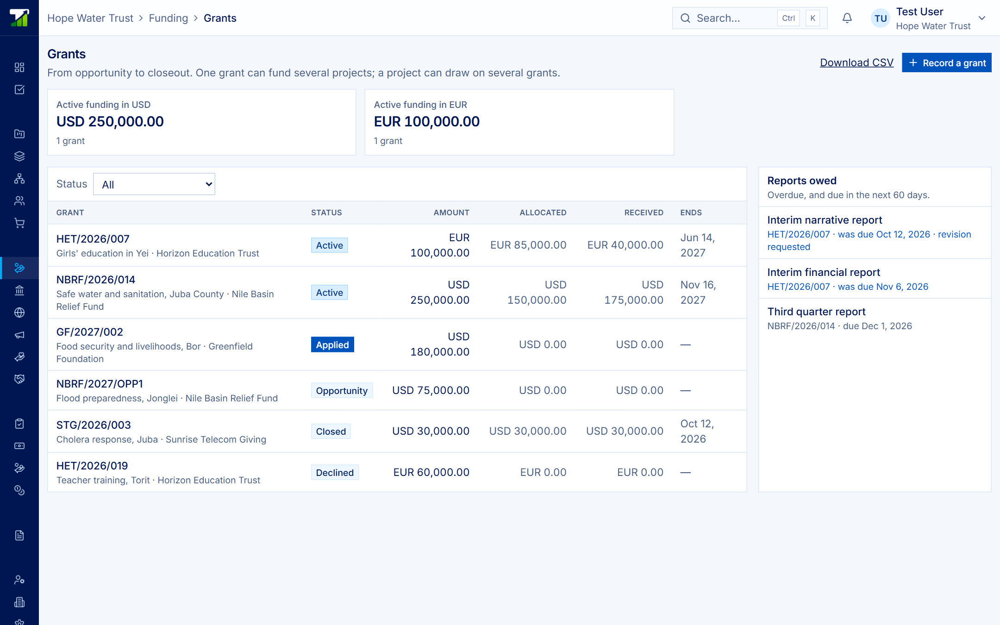

# Projects — User Guide

Live, editable version: https://claude.ai/artifact/GkkpofyfoBZi8xD8jpQjhV (this file is a copy as of 2026-11-11).

## What Projects is

Projects runs an organization's work, money and books in one browser workspace, and shares each grant's progress with its funder only as far as the organization chooses. Its one line: **Run your organization. Share what you choose.**

It is built for NGOs, the donors who fund them, and the finance and project teams in between. An organization can use it with no donor at all; when one organization funds another, a grant connects their two workspaces.

| Who you are | What Projects gives you |
| --- | --- |
| Delivering organization | Projects, tasks, budgets, spending, procurement, grants and double-entry books in one place |
| Funder or donor | One dashboard across every organization you fund, showing what they share and what waits for you |
| Finance team | Budgets someone else approves, spending checked before it is committed, books that post as payments are made |
| Project team | Board, list and timeline views, My work, a weekly timesheet, and purchases raised from inside the project |

Four principles run through the product:

- **The organization decides.** Every grant has its own sharing switches, all off until someone turns them on.
- **Different hands.** Whoever asks for money never approves or pays it; the system enforces this.
- **History stays.** Approved budgets never change, grant amendments are numbered, and spending is voided rather than deleted.
- **Figures that mean something.** Committed is kept apart from spent, and amounts in different currencies are never added together.

Projects runs in a browser and needs an internet connection. Offline field collection is not built.

## Getting started

You reach Projects at your organization's own address, `yourorganization.milesoftwares.com/projects`, and sign in once with your Tatook account.

1. **Create an account.** Sign up with email and verify it, or use Google when it is offered. One account can belong to several organizations.
2. **Set up your organization.** The person who sets it up becomes its owner. Name, currency and time zone belong to the workspace and are changed on the platform.
3. **Invite your team.** Members are invited with a one-time link from the workspace's Members page and given one or more roles (see Roles and permissions).
4. **Turn on the parts you use.** Administration → Settings switches Documents, Grants and funders, Procurement and Accounting on or off. Turning a part off hides it; nothing is deleted.
5. **Create your first project.** Portfolio → **New project**. Give it a short code (for example `WASH`), a manager, dates and a budget. Its tasks are then numbered `WASH-1`, `WASH-2` and so on.
6. **Add the budget and grant.** Draft a budget by category, submit it for approval, and if a donor funds the work, record the grant and allocate it to the project.

Your session belongs to the one workspace you signed in to. Moving to another organization is another sign-in, one click with single sign-on.

Keep your account safe from your account page: two-step sign-in with an authenticator app, one-time recovery codes, and a list of signed-in devices you can sign out remotely. Five failed sign-ins in a minute lock the address briefly.

## Using Projects

The left-hand menu groups everything into Overview, Projects, Funding, Finance, Records and Administration. Screens below come from a demo organization, Hope Water Trust.

### Portfolio

Portfolio is your home page: open projects, those at risk or off track, overdue tasks, and spend against open budgets, worst health first. Charts show tasks completed, paid expenses by month and budget used by project; each chart has a **Table** button for the figures behind it.

### A project

Each project has a code, a manager, dates, a budget and a status (planning, active, on hold, completed, cancelled). Its overview shows progress, milestones, what is coming up, the top risks and an activity log. Tabs across the top open Board, Tasks, Timeline, Team, Time, Budget, Spending, Risks, Deliverables and Changes.

**Health** is calculated for you:

- **Off track:** past its due date, or over budget.
- **At risk:** progress more than 20 points behind the time elapsed, any overdue task, or spend more than 20 points ahead of progress. Your organization can change the 20-point slack.
- Progress is weighted by each task's estimate.

### Tasks: board, list and timeline

See the same tasks three ways. On the **Board**, drag a card across columns to change its status, or within a column to reorder it. The **Tasks** list filters by person and milestone. The **Timeline** draws each task from start to due date, with milestones as diamonds and a line for today.

Each task has a priority, assignee, milestone, estimate, subtasks, a checklist, comments with mentions, attachments and the time logged on it. A task can wait on others: it cannot be marked done while they are open, and a dependency that would make a circle is refused.

### Team and time

Add people to a project with a role and a share of their time; allocation across all open projects shows who is overbooked. Log hours as `1.5` or `1:30`. Each entry is costed at the person's hourly cost when it is logged, and **My work** gives everyone a weekly timesheet.

### Budget

A budget is a set of lines by category: labour, materials, equipment, travel, subcontractors and other. You draft it, submit it, and someone else approves it or returns it with a reason. An approved version never changes; a revision is a new version, and it cannot cut a category below what is already committed or spent.

The Budget tab shows budget, committed, spent and available for each category, and the project's funding by grant.

### Spending and approvals

Spending moves through three hands:

1. **Request.** A team member asks for money against a budget category and, where a grant pays, that grant. Attach quotes and receipts.
2. **Approve.** Someone else approves it. Approval commits the money only if it fits what is left of the budget category and the grant's allocation. Larger amounts can need two or three approvers.
3. **Pay.** Finance records the payment date and reference. Paid spending posts to the books in the same step.

Whoever requested spending never approves or pays it. Rejected, cancelled and voided spending stays on record. **Finance → Approvals** lists everything waiting for you.

### Grants and funders

A grant moves from opportunity to applied, active (awarded) and closed, or declined. After the award, its amount and end date change only by a numbered amendment. Allocate one grant across several projects, or fund one project from several grants, across currencies with the rate recorded. Track the payment schedule and the reports owed; a grant closes only when no report is owed.

### Procurement, petty cash and advances

Buy through purchase request, approval, quotes, purchase order, goods received and supplier invoice, each step held apart by permission. Petty cash boxes each have a set amount and a custodian. Staff advances are requested, issued and retired.

### Risks, documents and audit

The risk register scores probability × impact from 1 to 25: 15 and above is high, 8 and above is medium. Each risk has an owner, a mitigation and a review date. Documents keep every version, and confidential ones stay with the people allowed to see them. Every security-relevant change is written to the audit log, which the app never edits or deletes.

## Roles and permissions

A member can hold more than one role, and the server checks every action again, whatever the screen shows. Roles are given on the workspace's Members page; a change applies on the member's next page load.

| Role | What they can do |
| --- | --- |
| Organization Administrator | Everything, plus approvals, grants, members' departments and teams, settings and the audit log |
| Project Manager | Everything on projects, including drafting and submitting budgets and requesting spending; organizes spaces and lists; sees grants |
| Team Member | View, work on tasks, log their own time, request spending |
| Viewer | View only |
| Finance Controller | View budgets, costs and people's costs; approve budgets and spending; record payments; manage funders and grants |
| Finance Officer | View budgets, costs and grants; record payments of approved spending |
| Funder contact | Only the donor portal of their own funder |

Administration → Members lists who has opened Projects and places each person in a department or team. Contractors who do not sign in can be added by hand under People.

## Working with donors

A donor and the organization it funds each keep their own workspace; a grant connects them only after the funded organization's administrator accepts, and that organization chooses what the donor sees.

**The life of a grant**

1. The donor invites the organization by name and email, as a beneficiary or an implementer.
2. The organization accepts and records the grant: award, numbered amendments, allocations to projects and a payment schedule.
3. The organization turns on what to share. Each switch stays off until someone turns it on.
4. The work is delivered. Tasks move, purchases are approved, and each paid expense posts to the books.
5. The organization submits reports with their documents; the donor sees each one once it is submitted.
6. The donor accepts a report or asks for a revision, which makes it owed again.

| Can be shared, per grant | Always stays with the organization |
| --- | --- |
| Approved budget by category | Suppliers and receipts |
| Paid spending lines and the committed total | Who requested or approved spending |
| Project progress: status, percent done, milestones | Staff and the cost of people |
| Project tasks: number, title, status, dates | Risks, internal notes, and who a task is assigned to |

The donor workspace shows one dashboard across every organization it funds: grants, payments expected, reports to decide and reports still owed. Totals are kept per currency and never added across currencies.

Projects is part of the Tatook platform. Sign-in, members and roles come from the platform, and paid spending and grant payments are sent to the Finance module's books.

## Questions and answers

**Why can't I mark a task done?** It waits on another task that is still open. Finish or remove that dependency first.

**Why was my spending request refused?** It is more than what is left in that budget category, or in the grant's allocation to the project. Ask for a budget revision or charge another grant.

**Why can't I approve my own request?** Whoever requests spending never approves or pays it. Another approver must act.

**Can I change an approved budget?** No. Draft a revision; once approved it replaces the old version, which stays on record.

**Why can't I close a grant?** A report is still owed, or charged spending on it is unpaid.

**What does my donor see?** Only what you switched on for that grant. Check the sharing switches on the grant page.

**I see a different organization's data, or none.** Your session belongs to one workspace. Open the right organization's address and sign in there.

**Can I work offline?** No. Projects runs in a browser and needs a connection.

**Not built yet:** monitoring and evaluation frameworks, records of people served, KoboToolbox and ODK field data, project templates and a calendar view, tenders and contract management, and connections to Microsoft 365, Google Workspace, Teams, Slack and Power BI.

## Getting help

Projects is made by Miles Global Softwares. For a demo, or questions about grants, the donor workspace, projects, procurement or accounting, use **Contact support** on the website or the help link in your workspace. Your organization administrator can also check the audit log to see who changed what.
